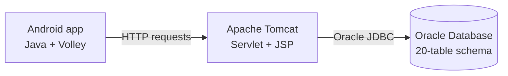
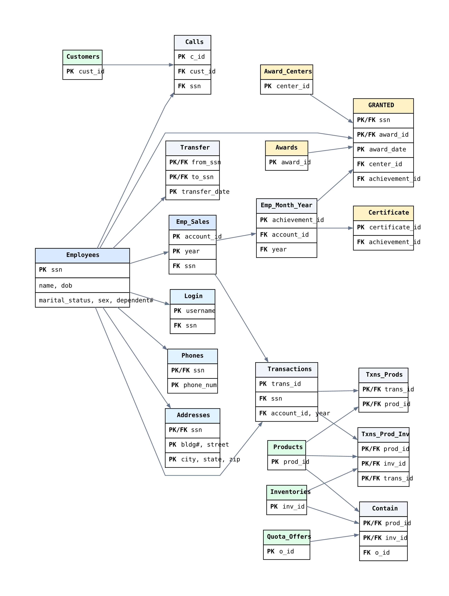

# SleepyHollow


SleepyHollow is an employee recognition and peer-to-peer transfer demo with a Java Android client, a Tomcat Servlet/JSP web tier, and an Oracle database. It is intended for learning and demonstrating mobile-to-server integration, employee sales and awards, transaction history, and transfers.

## Architecture



## Screenshots

Emulator screenshots are not included yet. Capture the dashboard, transaction history, and transfer screen on a configured Android emulator and add them under `SleepyHollow/docs/screenshots/` before publishing this as a visual portfolio project. The Android emulator connects to Tomcat at `10.0.2.2:8080` by default.

## What I Built

- I built the Android Java flows for sign-in, the employee dashboard, transaction history and details, award details, and peer-to-peer transfers.
- I connected the Android screens to Servlet/JSP endpoints using Volley and Oracle JDBC.
- I implemented the server-side queries and transfer flow against the employee, transaction, and award data model.
- I integrated a 20-table Oracle schema covering employees, sales, transactions, inventory, and awards, with supplementary sample data for local demonstrations.

## Oracle Schema

The schema includes employee and login records, sales and transaction history, awards and certificates, inventory, calls, and peer-to-peer transfers. The entity relationship diagram is generated from the checked-in DDL:



Source: [schema.dot](SleepyHollow/docs/schema.dot). The schema script drops matching existing tables before recreating them; run it only in a disposable development schema or after backing up any data you need.

## Setup

### Oracle Database

1. Create or select a disposable Oracle schema and configure an Oracle JDBC driver (`ojdbc11.jar`).
2. Connect as that schema owner and run `SleepyHollow/database/Create Tables (supplementary).sql`.
3. Optionally load the demonstration rows with `SleepyHollow/database/Dummy DataSet (supplementary).sql`.
4. Configure the JDBC URL and username in the JSP and servlet sources for your database. The password is read from the `DB_PASSWORD` environment variable; provide it to the Tomcat process without committing it.

The sample SQL contains test identities and login values. Do not use it as production data.

### Tomcat Web Tier

Use JDK 11 or newer and Apache Tomcat 10.1 or newer (the servlet uses `jakarta.servlet`). Deploy the contents of `SleepyHollow/web/` as the `sleepyhollow` web application under Tomcat's `webapps` directory, then compile the servlet into `WEB-INF/classes` and make Oracle's JDBC driver available in `WEB-INF/lib` or Tomcat's `lib` directory:

```sh
export CATALINA_HOME=/path/to/tomcat
export WEBAPP="$CATALINA_HOME/webapps/sleepyhollow"
mkdir -p "$WEBAPP"
cp -R SleepyHollow/web/. "$WEBAPP/"
mkdir -p "$WEBAPP/WEB-INF/classes"
javac -cp "$CATALINA_HOME/lib/servlet-api.jar" \
  -d "$WEBAPP/WEB-INF/classes" \
  SleepyHollow/web/WEB-INF/classes/Login/src/main/java/com/mycompany/login/Login.java
```

Place `ojdbc11.jar` in the web application's `WEB-INF/lib` (create the directory if needed), set `DB_PASSWORD` in the Tomcat service environment, and start Tomcat. The checked-in Maven descriptor currently contains placeholder dependency coordinates, so the `javac` deployment path above avoids relying on it.

### Android APK

Install Android Studio with JDK 17 or newer and Android SDK Platform 36. Create a local `local.properties` file in `SleepyHollow/android/` with your SDK path, start Tomcat on port `8080`, then build the debug APK:

```sh
cd SleepyHollow/android
./gradlew assembleDebug
```

The APK is written to `app/build/outputs/apk/debug/app-debug.apk`. The app currently targets the Android emulator host at `http://10.0.2.2:8080/sleepyhollow`; update the endpoint in the Java activities when using a physical device or a different server address.

## Security Note

This is a local educational demo, not a production-ready banking or employee-data application. It currently uses cleartext HTTP and sends credentials and employee identifiers in query parameters. Use synthetic data only, and do not expose it to the public internet without replacing those flows with authenticated HTTPS requests and server-side authorization.

## Project Layout

```text
SleepyHollow/
  android/    Android Studio project
  web/        Tomcat JSP pages and Servlet source
  database/   Oracle schema and demonstration data
  docs/       Schema diagram source and generated image
```